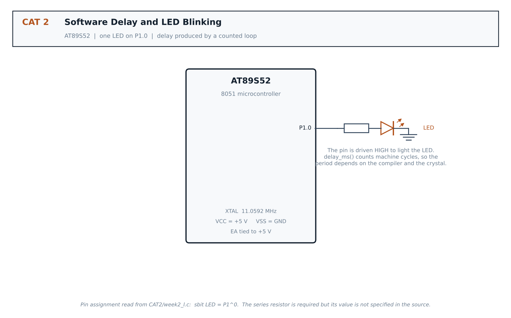

# CAT2 - 8051 Bare-Metal LED Blink & Delay Function

**EXP:** CAT2

**DATE:** 20/07/26

**NAME OF EXP:** 8051 Tool Chain Setup and Bare-Metal LED Blink

**HARDWARE SETUP / PLATFORM:**
- Microcontroller: AT89S52
- Architecture: 8051 (MCS-51)
- Development Board: AT89S52 Development Board
- Clock Frequency: 11.0592 MHz Crystal Oscillator
- On-board / External LED connected to Port 1 Pin 0 (P1.0)
- Current-limiting resistor: 330 Ω

**TASK NO:**
1. Hardware board bring-up and power supply verification.
2. Configure a GPIO pin for digital output and toggle an LED.
3. Implement a custom software delay function (`delay_ms`) using calibrated nested loops.

**Circuit Diagram:**



**Core Logic / Pseudocode / Code Base:**
```c
#include <reg51.h>

sbit LED = P1^0;

void delay_ms(unsigned int ms) {
    unsigned int i, j;
    for(i = 0; i < ms; i++) {
        for(j = 0; j < 120; j++); // Calibrated for ~1ms at 11.0592 MHz
    }
}

void main() {
    while(1) {
        LED = ~LED;      // Toggle LED state
        delay_ms(500);   // 500ms delay gives 1 Hz square wave
    }
}
```

**INFERENCE:**
The AT89S52 microcontroller was brought up and programmed to blink an LED on pin P1.0. The software delay loop was calibrated for an 11.0592 MHz crystal, where 1 machine cycle takes 1.085 µs. A regular 500 ms ON / 500 ms OFF blinking rate was confirmed on hardware.
