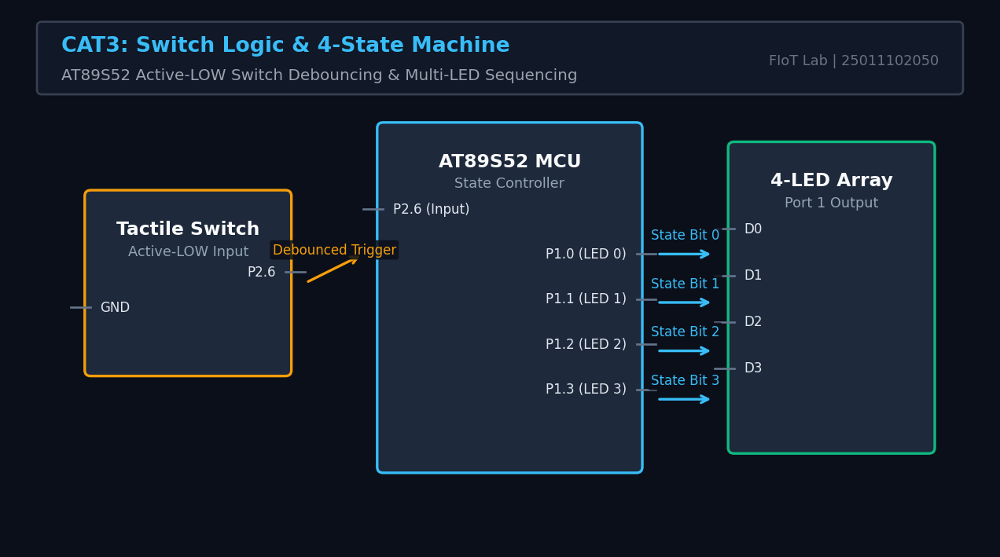

# CAT3: Tactile Switch Debouncing & Multi-State LED Machine

## 🎯 Objective
Implement an active-LOW pushbutton input with software debounce filtering and drive an interactive 4-state visual display sequence on a 4-LED array.

## ⚡ Hardware Architecture & Pinout
- **MCU:** AT89S52 (11.0592 MHz)
- **Input:** Tactile pushbutton connected to `P2^6` (Active-LOW with internal pull-up).
- **Control Signal:** `P2^3` pulled LOW to establish reference ground.
- **Outputs:** Port 1 lower nibble (`P1^0` to `P1^3`) connected to individual LEDs.

## 🧠 Engineering Implementation
1. **Mechanical Debounce Filter:** Reads `P2^6 == 0`, applies a 20 ms settling delay, re-samples the pin, and holds execution until button release (`while(P2^6 == 0)`) to ensure single-trigger operation per press.
2. **Finite State Machine (FSM):** A state variable cycles from `0` to `3` on consecutive debounced presses:
   - **State 0 (Running Light):** Single illuminated LED shifts from bit 0 to bit 3.
   - **State 1 (Binary Counter):** 4-bit binary accumulator counting from 0x0 to 0xF.
   - **State 2 (Alternating Pattern):** Complementary toggle (`0b0101` ↔ `0b1010`).
   - **State 3 (All-Flash):** Simultaneous synchronous blinking of all 4 LEDs.

## 📊 Verification & Results
- Clean state transitions observed without false-triggering or contact chatter.
- Preserved upper nibble `P1 & 0xF0` to prevent collateral pin disruption.
