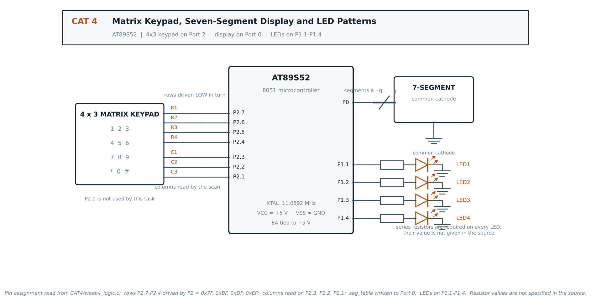

# CAT4 - 4x3 Matrix Keypad Scanning & 7-Segment Display

**EXP:** CAT4

**DATE:** 03/08/26

**NAME OF EXP:** Matrix Keypad Scanning with 7-Segment Display and LED Pattern Control

**HARDWARE SETUP / PLATFORM:**
- Microcontroller: AT89S52 (11.0592 MHz)
- Matrix Keypad: 4x3 keypad connected to Port 2 (Rows on P2.7-P2.4, Cols on P2.3-P2.1)
- Display: Common-cathode 7-segment display connected to Port 0 (P0.0 - P0.7)
- Pattern LEDs: Port 1 pins P1.1 - P1.4

**TASK NO:**
1. Implement row-by-row scanning of a 4x3 matrix keypad.
2. Decode pressed keys using a 7-segment lookup table and display the digit (0-9).
3. Trigger dedicated LED animation routines on special function keys with non-blocking key interruption.

**Circuit Diagram:**

**Core Logic / Pseudocode / Code Base:**
- **Keypad Scanning:** Drive Row 1 LOW (0x7F) and read columns; then Row 2 (0xBF), Row 3 (0xDF), and Row 4 (0xEF). If a column reads 0, return the corresponding key number.
- **7-Segment Lookup:** Code table `seg_table[10] = {0x3F, 0x06, 0x5B, 0x4F, 0x66, 0x6D, 0x7D, 0x07, 0x7F, 0x6F}` converts digit values to segment bitmasks.
- **LED Control:**
  - Key 1-4: Turns on individual LEDs (P1.1 to P1.4).
  - Key 5: Running LED animation across 3 cycles.
  - Key 6: Alternating LED blink.
  - Key 7: 4-bit binary counter.
  - Key 8: All LEDs blinking.
  - Key 0: Resets the system.
  - Animation routines re-scan the keypad between steps so newly pressed keys interrupt immediately.

**INFERENCE:**
Matrix scanning reduced the required pin count for 12 keys down to 7 GPIOs. The lookup table provided immediate digit decoding on the 7-segment display, and responsive key interruption was achieved during LED animations.
