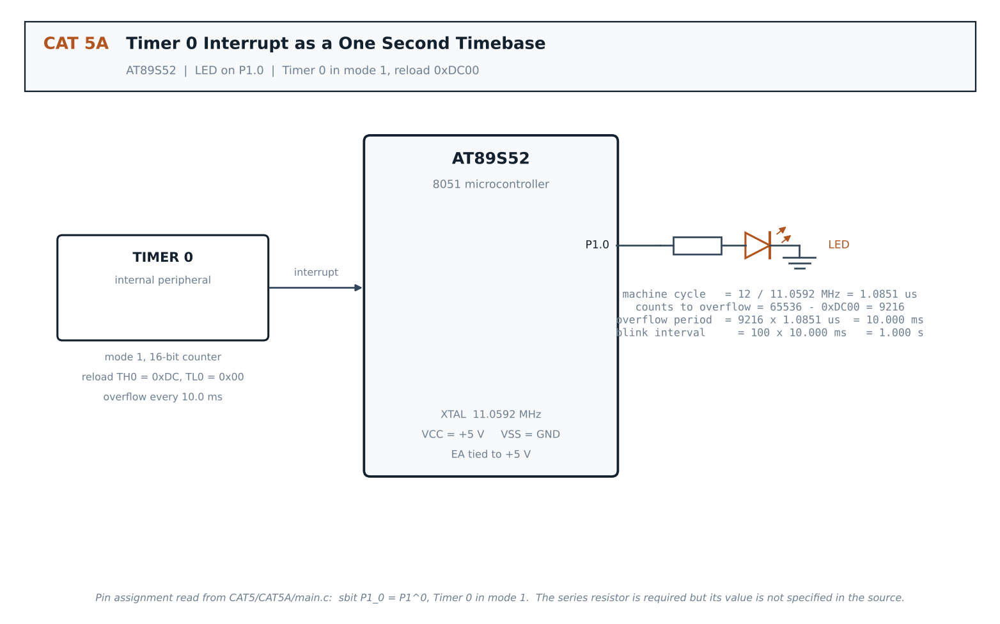

# CAT5A - Hardware Timer0 1-Second LED Blink & IDLE Sleep

**EXP:** CAT5A

**DATE:** 10/08/26

**NAME OF EXP:** Timer and Interrupt Programming - Hardware Timer0 1-Second LED Toggle

**HARDWARE SETUP / PLATFORM:**
- Microcontroller: AT89S52 (11.0592 MHz crystal)
- Timer Peripheral: Timer 0, Mode 1 (16-bit Timer/Counter)
- Output Pin: Port 1 Pin 0 (P1.0) connected to status LED

**TASK NO:**
1. Configure Timer 0 in 16-bit Mode 1 with interrupt generation.
2. Calculate the reload value for a 10 ms base tick and count 100 overflows to produce 1.0 second.
3. Put the CPU into low-power IDLE sleep mode between timer interrupts.

**Circuit Diagram:**

**Core Logic / Pseudocode / Code Base:**
- At 11.0592 MHz, 1 machine cycle is 1.085 µs. A 10 ms delay requires 9216 counts.
- Preload value: $65536 - 9216 = 56320 = 	ext{0xDC00}$ ($	ext{TH0} = 	ext{0xDC}, 	ext{TL0} = 	ext{0x00}$).
- Interrupt Service Routine (`timer0_isr` interrupt 1):
  - Reloads TH0 = 0xDC, TL0 = 0x00, clears TF0.
  - Increments tick counter `k`.
  - When `k >= 100`, toggles P1.0 and resets `k = 0`.
- Main loop executes `PCON |= 0x01` (IDLE mode), halting CPU clocks until the next interrupt arrives.

**INFERENCE:**
Using hardware Timer0 interrupts eliminated busy-waiting from the main loop and produced an accurate 1.0-second LED flash rate. The microcontroller remained in IDLE sleep between timer ticks, conserving power.
