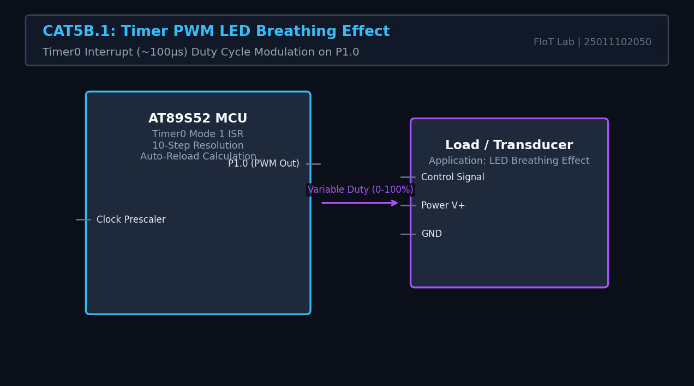

# CAT5B.1: High-Frequency Timer0 Software PWM Breathing LED

## 🎯 Objective
Synthesize a software Pulse Width Modulation (PWM) signal on a single GPIO pin using Timer0 interrupts to produce a smooth, logarithmic LED breathing luminance effect.

## ⚡ Hardware Architecture & Pinout
- **MCU:** AT89S52 (11.0592 MHz)
- **Output:** `P1^0` driving high-brightness LED.
- **Timer:** Timer 0 configured for ~100 µs high-frequency tick.

## 🧠 Engineering Implementation
1. **PWM Granularity:** Timer0 triggers every ~100 µs (`TH0=0xFF, TL0=0xA4`). Over 10 ticks, a full PWM period of 1.0 ms (1 kHz carrier frequency) is formed, eliminating visual flicker.
2. **Duty Cycle Modulation:** A software duty counter compares current cycle against target duty (0–10).
3. **Triangular Breathing Engine:** Every 500 ISR cycles, the duty cycle step ramps upward until peak brightness, then reverses downward in a smooth continuous cycle.

## 📊 Verification & Results
- 1 kHz PWM base frequency verified with smooth, human-eye-friendly brightness transitions.
