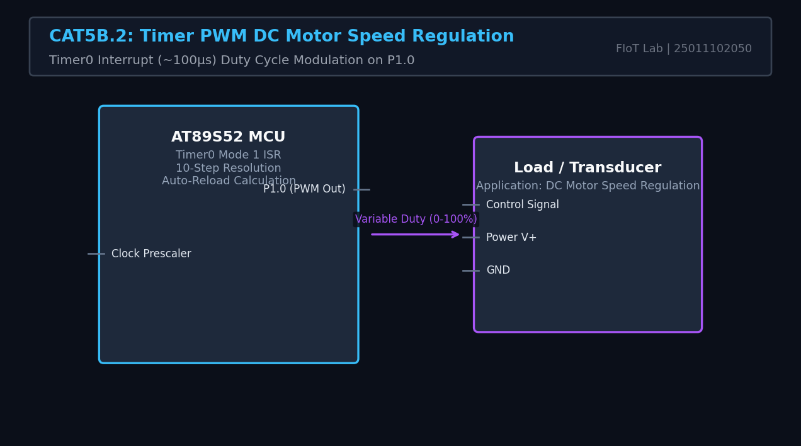

# CAT5B.2: PWM DC Motor Speed Regulation

## 🎯 Objective
Generate variable-duty PWM waveforms from the 8051 microcontroller to control the rotational speed and torque of a DC motor via an external driver interface.

## ⚡ Hardware Architecture & Pinout
- **MCU:** AT89S52
- **Output:** `P1^0` connected to driver logic input.
- **Driver:** L293D / NPN Transistor with flyback diode protection.

## 🧠 Engineering Implementation
1. **Duty Cycle Modulation:** Synthesizes variable average DC voltage across motor windings by adjusting the pulse-width ratio.
2. **Torque Compensation:** Maintains high base frequency to avoid audible acoustic noise while ensuring sufficient starting current at lower speed settings.
3. **Speed Ramp:** Software control profile safely steps motor current to prevent back-EMF spikes.

## 📊 Verification & Results
- Stable motor speed control demonstrated across 20% to 100% duty cycle ranges.
