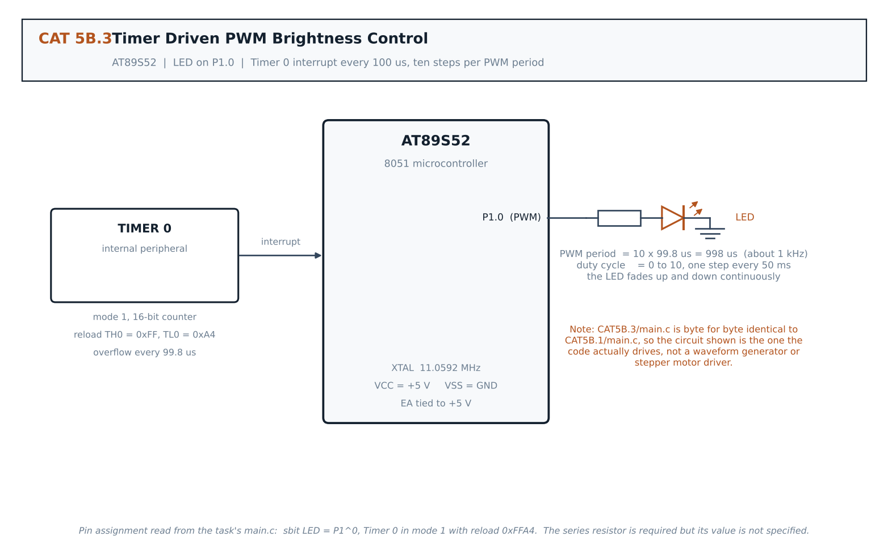

# CAT5B.3 - Timer PWM Servo Motor Angular Sweep

**EXP:** CAT5B.3

**DATE:** 10/08/26

**NAME OF EXP:** Hardware Timer and Interrupt-Based Timing - Servo Motor Angular Sweep

**HARDWARE SETUP / PLATFORM:**
- **Microcontroller:** AT89S52 (11.0592 MHz)
- **Output Pin:** Port 1 Pin 0 (`P1^0`) connected to Servo PWM signal line
- **Actuator:** SG90 9g Micro Servo Motor
- **Power Supply:** External regulated +5.0 V DC supply (common ground tied to 8051 ground)

**TASK NO:**
1. Synthesize a 50 Hz frame frequency (20 ms period) standard RC servo control signal.
2. Vary the active-HIGH pulse duration between 1.0 ms (-90°), 1.5 ms (0° center), and 2.0 ms (+90°).
3. Program a continuous angular sweep that moves the servo horn smoothly between -90° and +90°.

**Circuit Diagram:**

**Core Logic / Pseudocode / Code Base:**
- **RC Servo Timing Protocol:**
  - Repetition Rate: 50 Hz (Frame Period $T = 20 	ext{ ms}$).
  - Full Left Position (-90°): $T_{	ext{high}} = 1.0 	ext{ ms}$.
  - Neutral Center Position (0°): $T_{	ext{high}} = 1.5 	ext{ ms}$.
  - Full Right Position (+90°): $T_{	ext{high}} = 2.0 	ext{ ms}$.
  - Remaining time in each 20 ms cycle: Line held LOW.
- Timer 0 interrupts are configured to dynamically switch reload values between the high-pulse duration and the remaining low-time interval, maintaining a constant 20 ms total frame.

**INFERENCE:**
Precise pulse duration generation using Timer 0 allowed accurate angular positioning of the servo shaft. Maintaining an exact 20 ms frame rate ensured that internal servo feedback control remained stable without hunting or jitter.
