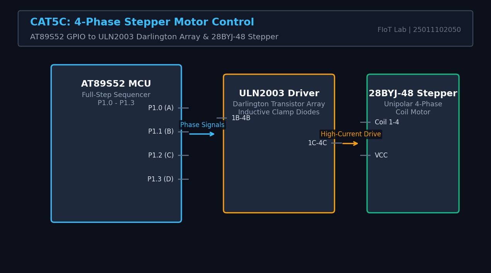

# CAT5C: 4-Phase Stepper Motor Full-Step Sequence

## 🎯 Objective
Interface a 28BYJ-48 unipolar stepper motor to the AT89S52 via a ULN2003 Darlington transistor array and drive precise rotational steps using a 4-phase full-step sequence.

## ⚡ Hardware Architecture & Pinout
- **MCU:** AT89S52
- **Outputs:** `P1.0`, `P1.1`, `P1.2`, `P1.3` (Phases A, B, C, D).
- **Driver:** ULN2003A (High-current open-collector Darlington pairs with internal clamp diodes).
- **Actuator:** 28BYJ-48 5V Stepper Motor (64:1 reduction gearbox).

## 🧠 Engineering Implementation
1. **Excitation Sequence:**
   - Step 1: `0b0001` (Phase A)
   - Step 2: `0b0010` (Phase B)
   - Step 3: `0b0100` (Phase C)
   - Step 4: `0b1000` (Phase D)
2. **Current Handling:** The ULN2003 isolates the 8051 GPIOs from the 200 mA inductive coil draw, while onboard freewheeling diodes suppress inductive switching spikes.
3. **Speed Regulation:** Inter-step software delay sets rotational velocity and prevents magnetic step slippage.

## 📊 Verification & Results
- Verified reliable bi-directional 360° shaft rotation with accurate step positioning.
