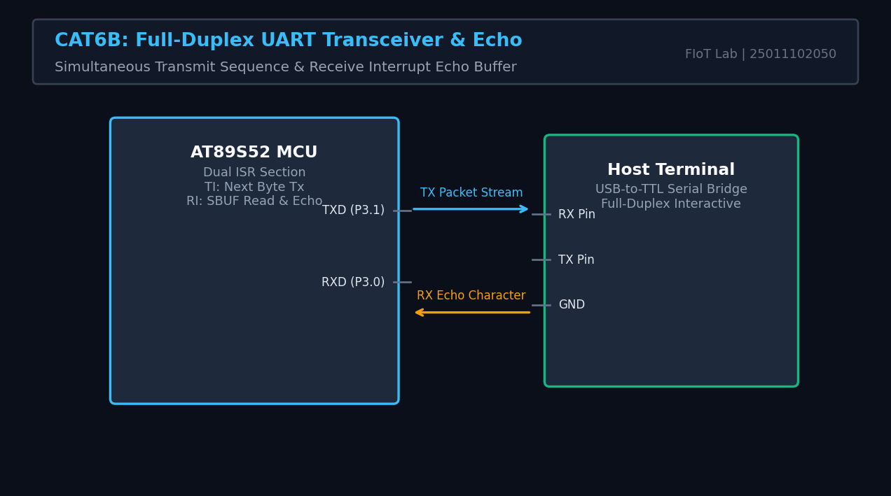

# CAT6B: Full-Duplex UART Transceiver with Loopback Echo

## 🎯 Objective
Implement full-duplex asynchronous communication on the AT89S52 that transmits an initialization stream while concurrently capturing, buffering, and echoing incoming terminal characters.

## ⚡ Hardware Architecture & Pinout
- **MCU:** AT89S52 (11.0592 MHz)
- **UART Interface:** `P3.1` (TXD), `P3.0` (RXD), Common Ground.
- **Baud Rate:** 9600 Baud (8N1).



## 🧠 Engineering Implementation
1. **Dual-Condition Interrupt Handler:**
   The serial ISR discriminates between transmit and receive triggers:
   ```c
   void serial_ISR(void) interrupt 4 {
       if (TI) { TI = 0; if (msg[idx]) SBUF = msg[idx++]; else done = 1; }
       if (RI) { RI = 0; SBUF = SBUF; } // Immediate hardware echo
   }
   ```
2. **Zero Polling Overhead:** Neither transmission nor reception stalls the central CPU loop.
3. **Echo Latency:** Near-zero loopback delay as received characters in `SBUF` are directly fed back into the transmit buffer upon `RI` interrupt asserting.

## 📊 Verification & Results
- Full-duplex bidirectional communication verified; typed keyboard characters echoed back instantaneously.
