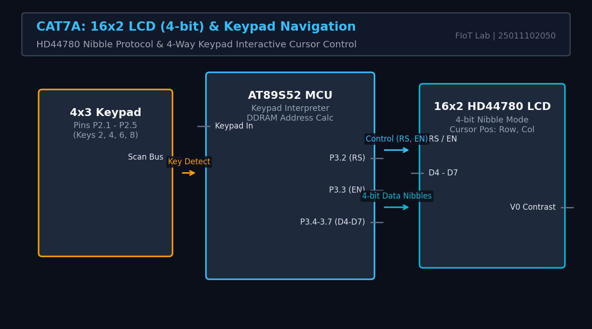

# CAT7A: 16x2 Character LCD 4-Bit Interface & Keypad Navigation

## 🎯 Objective
Interface an industry-standard HD44780 16x2 alphanumeric LCD in 4-bit nibble mode and control the visual position of a character (`*`) across the 2x16 matrix using directional keypad keys.

## ⚡ Hardware Architecture & Pinout
- **MCU:** AT89S52
- **LCD Control (Port 3):** `P3.2` (RS), `P3.3` (EN).
- **LCD Data Bus (Port 3):** `P3.4`–`P3.7` connected to LCD `D4`–`D7`.
- **4x3 Keypad (Port 2):** Keys 2 (Up), 8 (Down), 4 (Left), 6 (Right).

## 🧠 Engineering Implementation
1. **4-Bit Nibble Mode Initialization:**
   Frees 4 microcontroller I/O pins by sending high-nibble first, pulsing Enable (`EN`), followed by low-nibble. Initial sequence forces HD44780 controller into 4-bit mode (`0x30`, `0x30`, `0x30`, `0x20`).
2. **DDRAM Address Computation:**
   `lcd_goto(row, col)` writes command byte `0x80 | (row == 0 ? col : 0x40 + col)`.
3. **Cursor Navigation Engine:**
   Scans matrix keypad; keys 2/8 alter rows (clamped 0–1) and keys 4/6 alter columns (clamped 0–15). Old position is overwritten with `' '` and new coordinate receives `'*'`.

## 📊 Verification & Results
- Fluid, bounds-checked cursor mobility across all 32 LCD characters cells.
