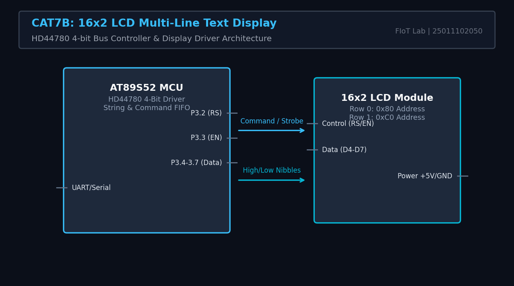

# CAT7B - 16x2 LCD Multi-Line Text Formatting & Display

**EXP:** CAT7B

**DATE:** 24/08/26

**NAME OF EXP:** LCD Interfacing and Display Control - Multi-Line Messages and Scrolling

**HARDWARE SETUP / PLATFORM:**
- **Microcontroller:** AT89S52
- **Display:** 16x2 Character LCD in 4-bit mode (RS=P3.2, EN=P3.3, D4-D7=P3.4-P3.7)
- **Source Files:** Modular LCD library (`lcd.c`, `lcd.h`, `main.c`)

**TASK NO:**
1. Develop an abstracted, modular C driver for alphanumeric LCD operations.
2. Print formatted strings across both lines of the 16x2 LCD display.
3. Implement hardware display shifting commands to create automated scrolling text banners.

**Circuit Diagram:**

**Core Logic / Pseudocode / Code Base:**
- **Driver Abstraction:**
  - `lcd_init()`: Hardware initialization and 4-bit mode handshake.
  - `lcd_cmd(uint8_t cmd)`: Writes instructions with RS=0.
  - `lcd_data(uint8_t data)`: Writes ASCII characters with RS=1.
  - `lcd_print(char *str)`: Iterates over null-terminated strings and streams characters to LCD.
- **Hardware Display Shifting:**
  Writing command `0x18` instructs the HD44780 internal controller to shift both lines left by one column address without modifying internal DDRAM data. Inserting a 300 ms delay between successive shifts produces a smooth marquee banner.

**INFERENCE:**
Modular driver encapsulation simplified multi-line string rendering and display management. Using built-in HD44780 display shift commands offloaded scrolling calculations from the microcontroller CPU.
