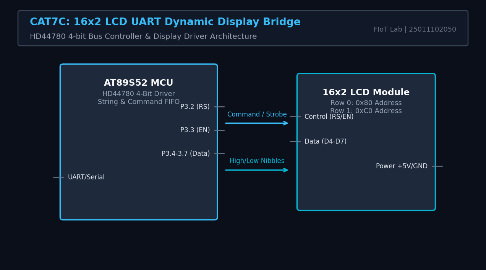

# CAT7C: Real-Time UART-to-LCD Display Bridge

## 🎯 Objective
Build a hardware-level communications bridge that listens to serial data streams from a remote terminal and prints incoming characters in real-time onto an alphanumeric LCD display.

## ⚡ Hardware Architecture & Pinout
- **MCU:** AT89S52
- **Serial Input:** `P3.0` (RXD) at 9600 Baud.
- **LCD Output:** HD44780 in 4-bit mode on Port 3.

## 🧠 Engineering Implementation
1. **Asynchronous Ingestion:** Serial interrupt captures received characters into an internal circular buffer.
2. **Control Character Filtering:** Handles special ASCII control codes (`
`, `
`, ``) to trigger clear screen (`0x01`) or return-to-home (`0x02`).
3. **Coordinated Bus Sharing:** Port 3 lines (`P3.0` for UART, `P3.2-P3.7` for LCD) coexist without interference by isolating strobe pulses exclusively during LCD enable assertions.

## 📊 Verification & Results
- Text typed into PC serial terminal appears instantly on the physical 16x2 LCD screen.
