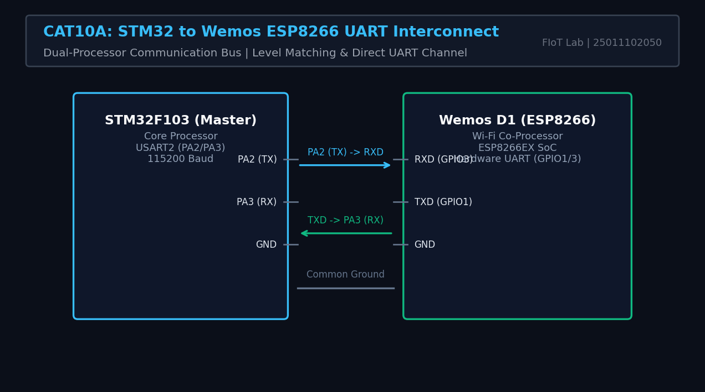

# CAT10A – STM32 to Wemos D1 (ESP8266) UART Bridge

**EXP:** CAT10A

**DATE:** 05/10/26

**NAME OF EXP:** Establish STM32 ↔ Wemos ESP8266 UART Communication

**HARDWARE SETUP / PLATFORM:**
- Host MCU: STM32F103C8T6
- Wi-Fi SoC: Wemos D1 Mini (ESP8266)
- Wiring:
  - STM32 PA2 (USART2_TX) -> Wemos RX (GPIO3)
  - STM32 PA3 (USART2_RX) -> Wemos TX (GPIO1)
  - Common Ground connected
- Debug Port: STM32 USART1 (PA9/PA10) connected to PC terminal

**TASK NO:**
1. Wire a dedicated hardware UART channel between the STM32F103 and Wemos D1 Mini.
2. Verify 3.3V logic level compatibility and baud rate matching (115200 Baud).
3. Implement a transparent bidirectional bridge relaying bytes between PC (USART1) and ESP8266 (USART2).

**Circuit Diagram:**

**Core Logic / Pseudocode / Code Base:**
- Both chips operate on 3.3V I/O, allowing direct connection without level converters.
- Firmware loops reading USART1 (PC commands) and forwarding to USART2 (ESP8266).
- Simultaneously reads USART2 (ESP8266 responses) and forwards to USART1 (PC console).

**INFERENCE:**
A transparent serial bridge was established. Commands sent from the PC reached the ESP8266, and modem responses were displayed back on the PC monitor without character loss.
