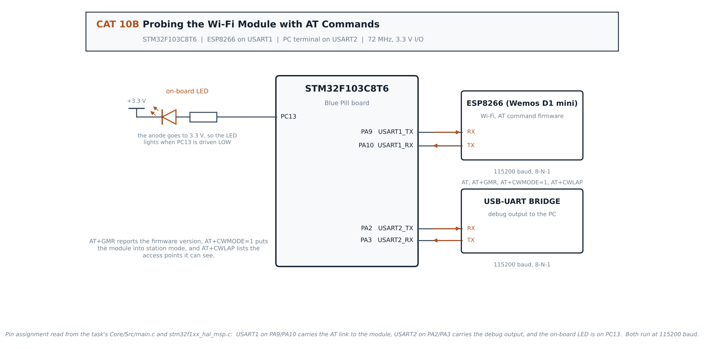

# CAT10B – ESP8266 AT Command Protocol Handshake

**EXP:** CAT10B

**DATE:** 05/10/26

**NAME OF EXP:** Explore ESP8266 AT Command Interface

**HARDWARE SETUP / PLATFORM:**
- **Host MCU:** STM32F103C8T6
- **Wi-Fi Modem:** ESP8266 Wemos D1 Mini loaded with Espressif AT firmware (v1.7+)
- **Interface:** USART2 at 115200 Baud (8N1)

**TASK NO:**
1. Send initial `AT` synchronization test commands to probe modem readiness.
2. Query firmware and SDK build information using `AT+GMR`.
3. Perform a software reboot using `AT+RST` and synchronize with post-boot modem output.

**Circuit Diagram:**

**Core Logic / Pseudocode / Code Base:**
- Command Sequence:
  1. `AT
` $\implies$ Expect `OK` response to confirm UART communication.
  2. `AT+GMR
` $\implies$ Query AT version, SDK version, and compile timestamp.
  3. `AT+RST
` $\implies$ Issue hardware reset command and wait for the `ready` response string.
- Response Parsing: Response stream is buffered and checked for `OK`, `ERROR`, or `busy p...` delimiters with bounded timeouts.

**INFERENCE:**
The AT command protocol state machine on the ESP8266 was verified. The modem responded correctly to standard supervisory commands, proving reliable inter-processor communication and firmware health.
