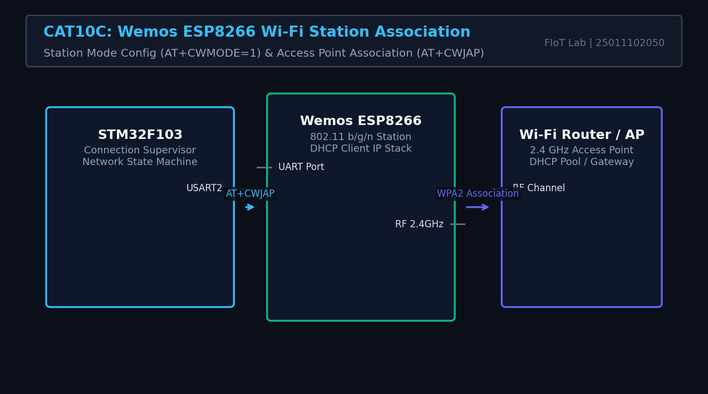

# CAT10C: Wemos ESP8266 Wi-Fi Station Mode Network Association

## 🎯 Objective
Automate Wi-Fi Station (STA) mode initialization and network association on the ESP8266 from the STM32 host to join a 2.4 GHz IEEE 802.11 b/g/n wireless local area network.

## ⚡ Hardware Architecture & Pinout
- **Host Controller:** STM32F103C8T6
- **Wi-Fi Modem:** ESP8266 Wemos D1 Mini
- **Network Interface:** 2.4 GHz Wi-Fi Access Point / Router with WPA2-PSK.

## 🧠 Engineering Implementation
1. **Station Mode Configuration:**
   - Issues `AT+CWMODE=1` to enforce Wi-Fi Station role (disabling SoftAP to reduce RF overhead).
2. **WPA2 Association:**
   - Dispatches `AT+CWJAP="SSID","PASSWORD"` with extended timeout (10–15 s).
   - Monitors response stream for `WIFI CONNECTED`, `WIFI GOT IP`, and final confirmation `OK`.
3. **Network Status Verification:** Queries assigned IPv4 lease and MAC address using `AT+CIFSR`.

## 📊 Verification & Results
- ESP8266 successfully associates with Wi-Fi AP and obtains a dynamic DHCP IP address.
