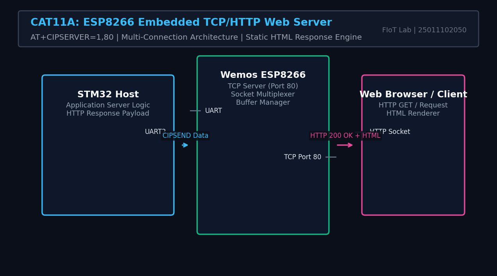

# CAT11A: ESP8266 Embedded TCP/HTTP Web Server

## 🎯 Objective
Configure the ESP8266 as a multi-connection TCP server listening on Port 80, parse incoming HTTP GET requests, and deliver static HTML response payloads to browser clients.

## ⚡ Hardware Architecture & Pinout
- **Host:** STM32F103C8T6
- **Wi-Fi Server:** ESP8266 Wemos D1 Mini (Port 80 HTTP listener)
- **Client:** Web Browser / HTTP Client on the local Wi-Fi subnet.

## 🧠 Engineering Implementation
1. **Multi-IP Socket Setup:**
   - `AT+CIPMUX=1` enables multi-connection socket multiplexing (channels 0–4).
   - `AT+CIPSERVER=1,80` starts TCP server listening on default HTTP port 80.
2. **Request Parsing:** Traps incoming data stream indicator `+IPD,<channel>,<len>:GET / HTTP/1.1`.
3. **Response Assembly:**
   - Prepares HTTP 200 OK header with `Content-Type: text/html`.
   - Issues `AT+CIPSEND=<channel>,<bytes>` followed by the HTML payload.
   - Closes connection via `AT+CIPCLOSE=<channel>` to release socket descriptor.

## 📊 Verification & Results
- Browser navigated to ESP8266 IP renders the status webpage successfully.
