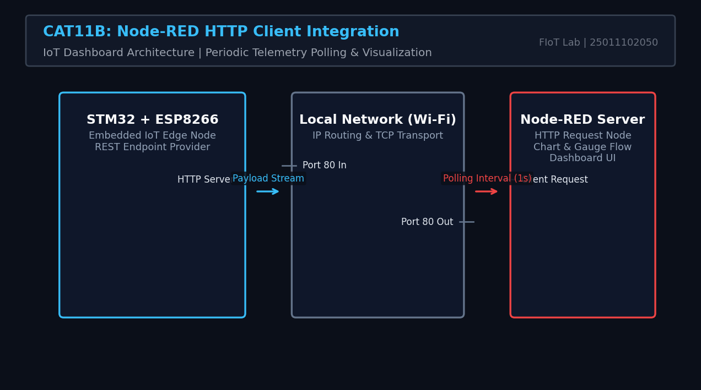

# CAT11B: IoT Edge Integration with Node-RED HTTP Client

## 🎯 Objective
Integrate the STM32/ESP8266 embedded server with a Node-RED IoT dashboard by configuring Node-RED as an HTTP client that periodically polls telemetry and visualizes live state.

## ⚡ Hardware Architecture & Pinout
- **Embedded Server:** STM32F103 + ESP8266 Wemos D1 Mini (IP: `192.168.x.x`, Port 80).
- **Dashboard Host:** PC running Node-RED flow engine.



## 🧠 Engineering Implementation
1. **JSON Payload Formatting:** STM32 constructs structured JSON objects containing sensor values, system uptime, and LED status:
   ```json
   {"uptime": 1420, "led_state": 1, "status": "ONLINE"}
   ```
2. **Node-RED Flow Architecture:**
   - **Inject Node:** Triggers recurring HTTP GET request every 2 seconds.
   - **HTTP Request Node:** Queries `http://<ESP_IP>/status`.
   - **JSON Parser Node:** Deserializes JSON string into `msg.payload` properties.
   - **Dashboard UI Nodes:** Binds telemetry to digital gauges, trend charts, and text cards.

## 📊 Verification & Results
- Live real-time telemetry graphs updated continuously in the Node-RED dashboard.
