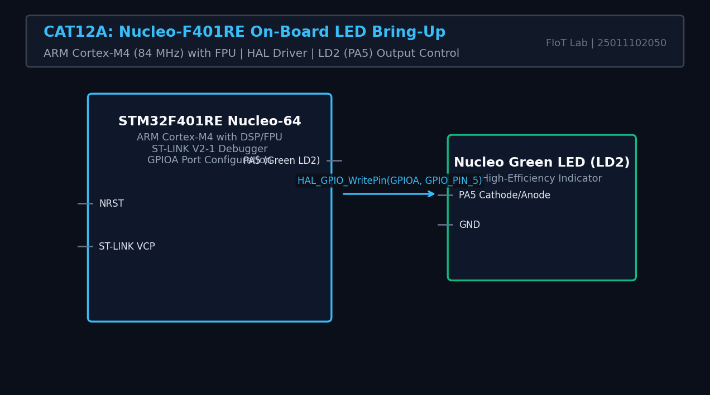

# CAT12A – Nucleo-F401RE On-Board LED Bring-Up

**EXP:** CAT12A

**DATE:** 23/10/26

**NAME OF EXP:** On-Board LED Bring-Up (NUCLEO-F401RE)

**HARDWARE SETUP / PLATFORM:**
- **Development Board:** STMicroelectronics NUCLEO-F401RE
- **Microcontroller:** STM32F401RET6 (ARM Cortex-M4 with FPU and DSP, 84 MHz, 512 KB Flash, 96 KB SRAM)
- **Target Peripheral:** On-board User Green LED (`LD2`) connected to Pin PA5
- **Programming Interface:** Embedded ST-LINK/V2-1 via Mini-USB connector

**TASK NO:**
1. Configure the STM32F401RE clock tree for 84 MHz peak frequency using the 16 MHz HSI clock and internal PLL.
2. Configure pin PA5 as a push-pull digital output using STM32Cube HAL.
3. Toggle green LED LD2 at a 1.0 Hz rate (500 ms ON / 500 ms OFF) inside the main application loop.

**Circuit Diagram:**



**Core Logic / Pseudocode / Code Base:**
- **Clock Tree:**
  $	ext{HSI (16 MHz)} 
ightarrow 	ext{PLLM (/16)} 
ightarrow 	ext{PLLN (x336)} 
ightarrow 	ext{PLLP (/4)} \implies 	ext{SYSCLK} = 84 	ext{ MHz}$.
- **Firmware Implementation:**
```c
int main(void) {
    HAL_Init();
    SystemClock_Config();
    MX_GPIO_Init();

    while (1) {
        HAL_GPIO_TogglePin(GPIOA, GPIO_PIN_5); // Toggle Green LED LD2
        HAL_Delay(500); // 500 ms delay
    }
}
```

**INFERENCE:**
The high-performance ARM Cortex-M4 Nucleo-64 platform was brought up and operational at 84 MHz. Output control of green LED LD2 on pin PA5 was verified with accurate 1.0 Hz timing.
