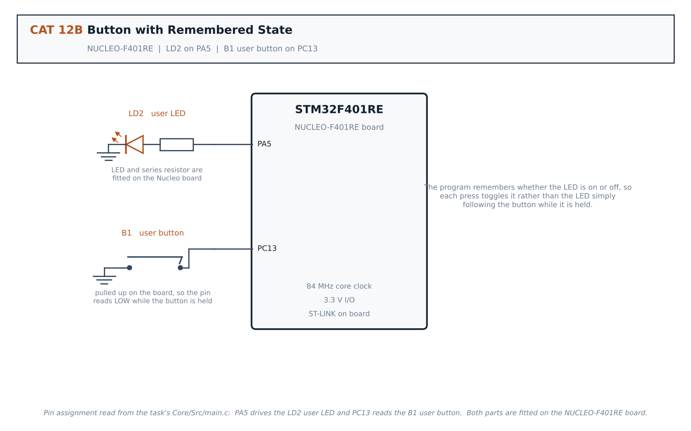

# CAT12B – Nucleo Pushbutton Control with State Memory

**EXP:** CAT12B

**DATE:** 23/10/26

**NAME OF EXP:** On-Board Switch Control with State Remembrance

**HARDWARE SETUP / PLATFORM:**
- Board: NUCLEO-F401RE
- Input: On-board Blue Pushbutton B1 connected to PC13 (Active-LOW)
- Output: Green LED LD2 connected to PA5

**TASK NO:**
1. Configure PC13 as an input pin to monitor user button B1.
2. Implement software debouncing to avoid false button clicks.
3. Maintain a persistent state memory latch that toggles the LED state upon every valid press.

**Circuit Diagram:**

**Core Logic / Pseudocode / Code Base:**
- Reads PC13 (`HAL_GPIO_ReadPin(GPIOC, GPIO_PIN_13) == GPIO_PIN_RESET`).
- Software debounces with 20 ms delay and verifies contact hold.
- Inverts state variable `led_state = !led_state`.
- Writes new state to PA5 using `HAL_GPIO_WritePin(GPIOA, GPIO_PIN_5, led_state)`.
- Waits for button release before continuing.

**INFERENCE:**
The persistent state memory latch worked reliably. Pressing the blue button toggled the green LED and remembered its state indefinitely until the next press.
