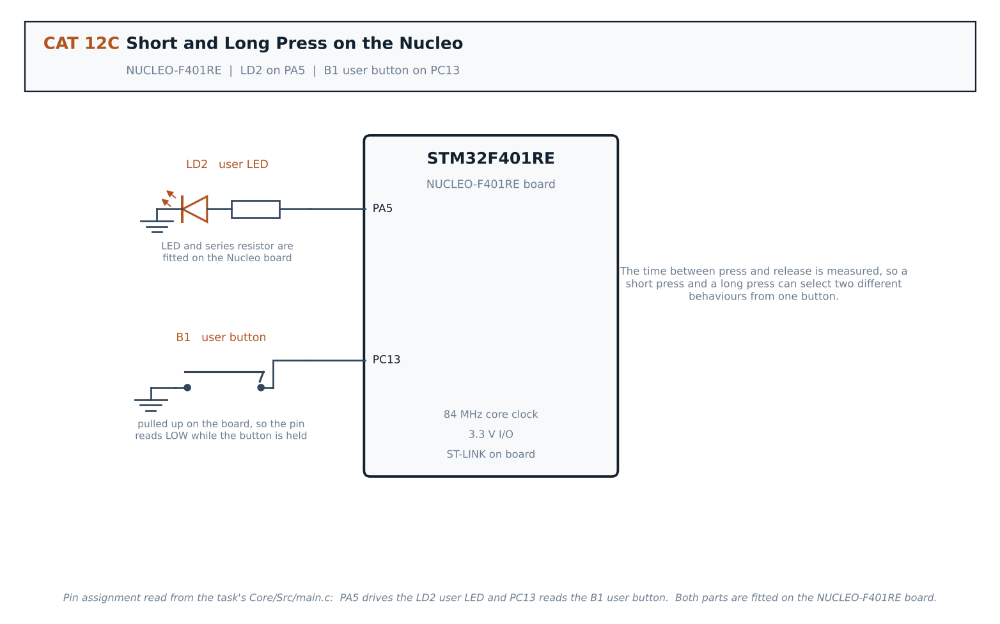

# CAT12C – Nucleo Short-Press and Long-Press Detection

**EXP:** CAT12C

**DATE:** 23/10/26

**NAME OF EXP:** Short-Press and Long-Press Detection (NUCLEO-F401RE)

**HARDWARE SETUP / PLATFORM:**
- **Board:** NUCLEO-F401RE (Cortex-M4, 84 MHz)
- **Input:** Blue User Button B1 (PC13)
- **Output:** Green User LED LD2 (PA5)

**TASK NO:**
1. Use `HAL_GetTick()` to measure the exact millisecond duration of user button B1 presses.
2. Classify the duration into Short Press (< 1000 ms) or Long Press (≥ 1000 ms).
3. Execute a single state toggle on short press, and a rapid 10-blink alarm burst on long press.

**Circuit Diagram:**

**Core Logic / Pseudocode / Code Base:**
- On falling edge (`PC13 == RESET`), record `t_start = HAL_GetTick()`.
- Wait in a loop until button release (`PC13 == SET`), record `t_release = HAL_GetTick()`.
- Calculate press duration: $\Delta t = t_{	ext{release}} - t_{	ext{start}}$.
  - If $\Delta t < 1000 	ext{ ms}$: Short Press $\implies$ Invert LED LD2 once.
  - If $\Delta t \ge 1000 	ext{ ms}$: Long Press $\implies$ Execute rapid 10-blink alarm pattern (50 ms ON / 50 ms OFF).

**INFERENCE:**
Using SysTick timestamps for press duration classification successfully multiplexed the functionality of a single tactile button. Short taps and long holds triggered independent operational routines with high reliability.
