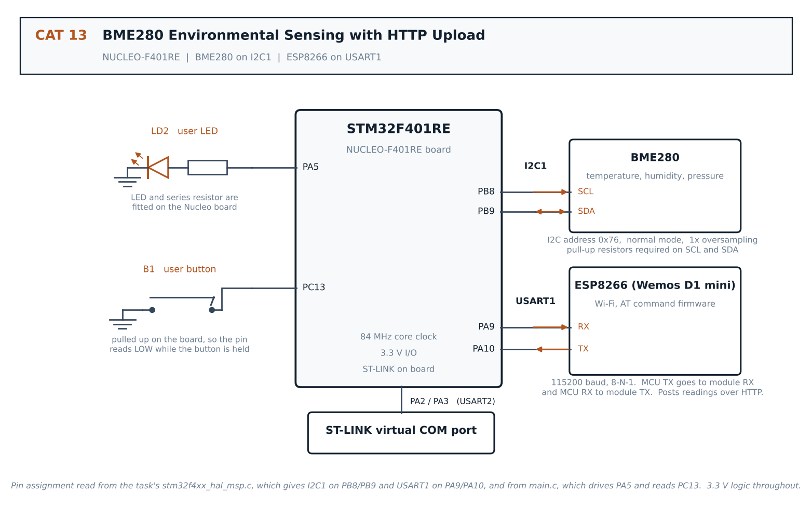

# CAT13 – BME280 Environmental Sensor & HTTP Telemetry

**EXP:** CAT13

**DATE:** 27/10/26

**NAME OF EXP:** Sensor Interfacing (BME280) – STM32 Debug – ESP8266 Wi-Fi HTTP – Node-RED Analytics

**HARDWARE SETUP / PLATFORM:**
- **Microcontroller:** STM32F401RE Nucleo-64
- **Environmental Sensor:** Bosch BME280 (Combined Temperature, Humidity, and Pressure sensor)
  - Interfacing: I2C1 Bus
  - PB8 $\implies$ I2C1_SCL
  - PB9 $\implies$ I2C1_SDA
  - Device I2C Address: `0x76` (or `0x77`)
- **Wireless Modem:** ESP8266 Wemos D1 Mini connected to STM32 USART1 (PA9/PA10)
- **Analytics Host:** PC running Node-RED dashboard

**TASK NO:**
1. Initialize the BME280 sensor over I2C1 and read factory trimming calibration coefficients from non-volatile memory.
2. Read raw ADC data for temperature, humidity, and atmospheric pressure, and apply Bosch compensation formulas.
3. Package calibrated measurements into JSON format and transmit via HTTP POST requests to a Node-RED endpoint over Wi-Fi.

**Circuit Diagram:**



**Core Logic / Pseudocode / Code Base:**
- **I2C Driver & Calibration:**
  1. Write to register `0xF4` (ctrl_meas) and `0xF5` (config) to set normal mode, 16x oversampling, and 0.5 ms standby.
  2. Read 24 calibration bytes (`dig_T1..T3`, `dig_P1..P9`, `dig_H1..H6`).
  3. Execute Bosch 32-bit integer arithmetic compensation formulas to compute true temperature (°C), relative humidity (%RH), and barometric pressure (hPa).
- **HTTP Payload Serialization:**
  ```c
  char json_payload[128];
  sprintf(json_payload, "{"temp":%.2f,"hum":%.2f,"press":%.2f}", temp, hum, press);
  // Send via ESP8266 AT commands: AT+CIPSTART -> AT+CIPSEND -> HTTP POST -> AT+CIPCLOSE
  ```

**INFERENCE:**
The entire sensor-to-cloud IoT data acquisition pipeline was validated. Temperature, humidity, and barometric pressure were acquired via I2C, compensated accurately using factory trimming parameters, and transmitted over Wi-Fi to live Node-RED dashboard gauges.
