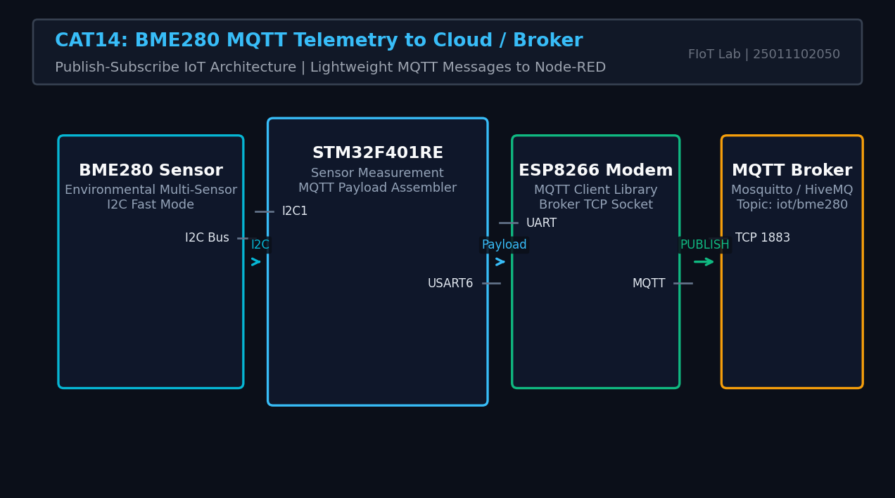

# CAT14: BME280 MQTT Telemetry to Cloud Broker & Node-RED

## 🎯 Objective
Implement an industrial-grade IoT telemetry pipeline using the lightweight MQTT protocol, publishing BME280 sensor metrics from an STM32F401RE through an ESP8266 modem to an MQTT broker and Node-RED subscribers.

## ⚡ Hardware Architecture & Pinout
- **Controller:** STM32F401RE Nucleo-64
- **Sensor:** BME280 (I2C1 on `PB8`/`PB9`)
- **Modem:** ESP8266 running MQTT client firmware (USART at 115200 Baud)
- **Broker:** Local Mosquitto / Cloud MQTT Broker (`port 1883`)
- **Subscriber:** Node-RED IoT Dashboard



## 🧠 Engineering Implementation
1. **MQTT Protocol Stack:**
   - Connects to broker with ClientID, KeepAlive (60s), and CleanSession flags.
   - Publishes telemetry payloads under hierarchical topic: `iot/environment/bme280`.
2. **Payload Serialization:**
   ```json
   {
     "device_id": "STM32F4_NUCLEO_25011102050",
     "temperature": 26.42,
     "humidity": 58.10,
     "pressure": 1012.35,
     "timestamp": 128450
   }
   ```
3. **Pub/Sub Decoupling:** Eliminates tight HTTP request/response coupling; multiple dashboard clients subscribe to the telemetry topic concurrently with negligible network overhead.

## 📊 Verification & Results
- High-throughput, low-latency telemetry verified on Mosquitto broker and Node-RED visual gauges.
