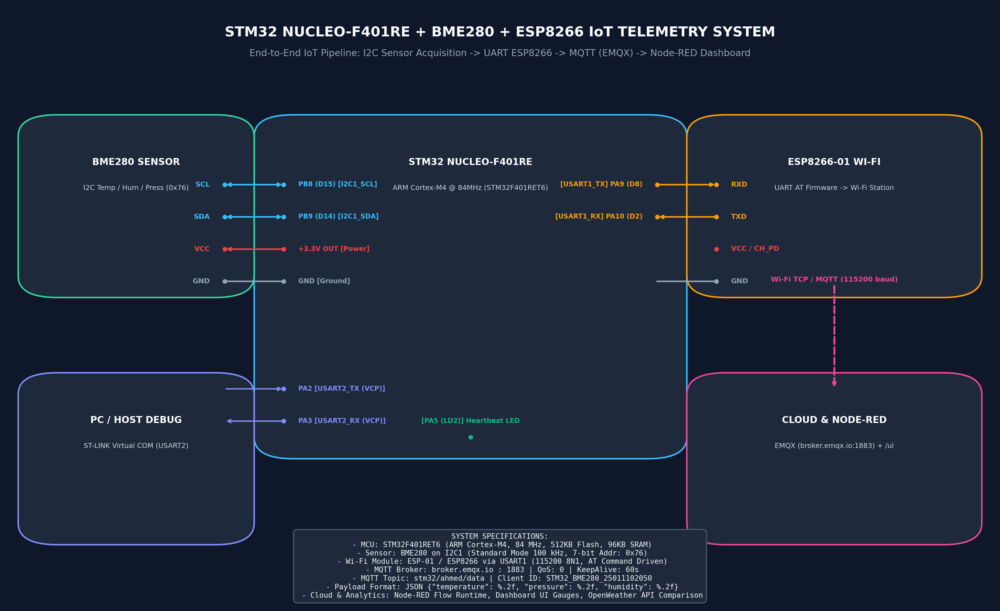
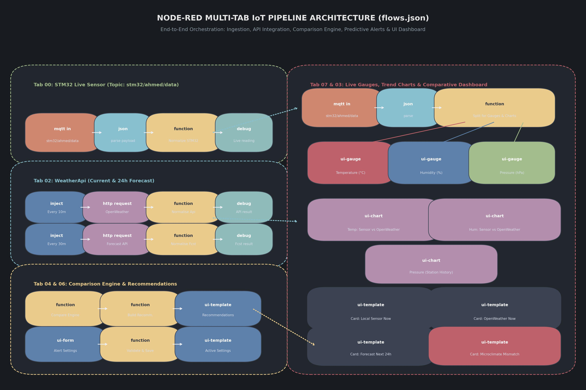

# CAT15 – Real-Time Environmental Sensing, Cloud Weather Comparison and Node-RED Analytics

**EXP:** CAT15

**DATE:** 9/11/26

**NAME OF EXP:** Real-Time Environmental Sensing, Cloud Weather Analytics and Comparative Dashboard

**HARDWARE SETUP / PLATFORM:**
- **Microcontroller:** STM32 NUCLEO-F401RE (ARM Cortex-M4 @ 84 MHz)
- **Sensor:** Bosch BME280 Digital Temperature, Humidity & Barometric Pressure Sensor
  - Communication: I2C1 (PB8 - SCL, PB9 - SDA), 7-bit Address `0x76` (0xEC shifted)
- **Wireless Interface:** ESP8266-01 Wi-Fi Module
  - Communication: USART1 (PA9 - TX, PA10 - RX) at 115200 baud
- **Host Debug:** ST-LINK Virtual COM Port (USART2: PA2 - TX, PA3 - RX)
- **IoT Protocol & Broker:** MQTT via TCP over Wi-Fi (`broker.emqx.io:1883`, QoS 0)
- **MQTT Topic:** `stm32/ahmed/data`
- **Cloud Weather Source:** OpenWeatherMap REST API (Current Conditions & 24h Forecast)
- **Dashboard & Orchestration:** Node-RED Flow Runtime (`http://localhost:1880/ui`)

**TASK NO:**
1. Initialize the BME280 environmental sensor over I2C1 and read device ID register `0xD0` to verify sensor presence.
2. Read factory calibration coefficients and compute compensated floating-point temperature (°C), relative humidity (% RH), and atmospheric pressure (hPa).
3. Connect ESP8266 to local Wi-Fi, establish a TCP socket to MQTT broker `broker.emqx.io:1883`, and publish telemetry JSON packets under topic `stm32/ahmed/data`.
4. Build a comprehensive multi-tab Node-RED architecture to ingest live sensor MQTT telemetry, query OpenWeatherMap APIs, execute a real-time comparison engine, and render interactive gauges, trend charts, and alert recommendations.

**Circuit Diagram:**



**Core Logic / Pseudocode / Code Base:**
- **Firmware Implementation Highlights (`Core/Src/main.c`):**
  - **I2C Sensor Calibration & Readout:**
    The BME280 sensor requires reading 26 bytes of trimming parameters from registers `0x88`–`0xA1` and 7 bytes from `0xE1`–`0xE7`. The 20-bit raw ADC registers (`0xF7`–`0xFE`) are read burst-wise to prevent time-skew between measurements. Double-precision Bosch compensation formulas convert raw counts into true environmental units.
  - **AT-Command MQTT Network Stack:**
    The STM32 drives the ESP8266 modem via USART1 using standard AT sequences:
    ```c
    ESP8266_Init(StationMode, huart1);
    ESP8266_wifiConnect("SNUC", "snu12345");
    ESP8266_portConnect("TCP", "broker.emqx.io", "1883");
    MQTT_connectBroker(&mqttSetting);
    ```
  - **Telemetry JSON Packet Framing:**
    ```c
    sprintf(mqttMessage,
            "{\"temperature\":%.2f,\"pressure\":%.2f,\"humidity\":%.2f}",
            (double)temperature,
            (double)(pressure / 100.0f),
            (double)humidity);
    MQTT_publishTopic("stm32/ahmed/data", mqttMessage, QoS0);
    ```
- **Node-RED Multi-Tab Data Pipeline (`node_red_flow.json`):**
  - **Tab 00 (STM32 Live Ingestion):** Subscribes to `stm32/ahmed/data`, parses JSON payloads, normalizes sensor metrics, and routes data to dashboard gauges.
  - **Tab 02 (WeatherApi Integration):** Triggers scheduled HTTP GET requests to OpenWeatherMap to fetch local ambient weather and a 24-hour meteorological forecast.
  - **Tab 04 (Analytical Comparison Engine):** Computes microclimate mismatches in real time:
    $$\Delta T = |T_{\text{sensor}} - T_{\text{weather}}|$$
    $$\Delta H = |H_{\text{sensor}} - H_{\text{weather}}|$$
    $$\Delta P = |P_{\text{sensor}} - P_{\text{weather}}|$$
    $$T_{\text{avg}} = \frac{T_{\text{sensor}} + T_{\text{weather}}}{2}, \quad H_{\text{avg}} = \frac{H_{\text{sensor}} + H_{\text{weather}}}{2}, \quad P_{\text{avg}} = \frac{P_{\text{sensor}} + P_{\text{weather}}}{2}$$
  - **Tab 05 & 06 (Alert Configuration & Recommendations):** Validates configurable threshold boundaries and derives contextual recommendations (e.g., ventilation suggestions and comfort index warnings).
  - **Tab 07 & 03 (Live Dashboard & Trend Charts):** Renders responsive gauges for Temperature, Humidity, and Pressure alongside historical comparison plots.

**Node-RED Flow Architecture:**



**INFERENCE:**
The integration of embedded sensing, wireless MQTT telemetry, and cloud analytics demonstrates a complete end-to-end IoT system. The STM32 Nucleo-F401RE reliably acquired high-precision environmental metrics from the BME280 and published lightweight JSON telemetry via the ESP8266 modem with minimal latency. Node-RED ingested the telemetry stream and contrasted local microclimate measurements against cloud weather API observations. The comparative engine identified localized indoor temperature and humidity offsets from ambient regional weather, validating the importance of hyper-local sensing in smart building and environmental automation.
