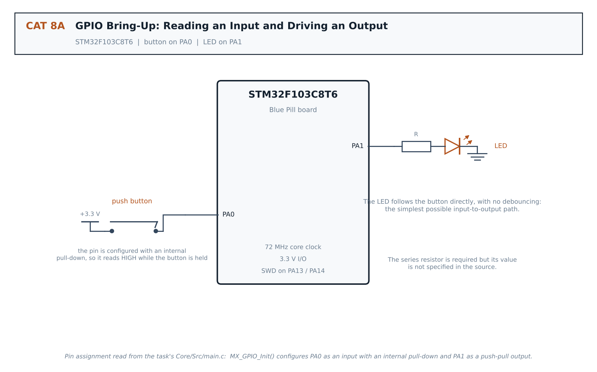

# CAT8A – STM32 GPIO Output Bring-Up

**EXP:** CAT8A

**DATE:** 18/09/26

**NAME OF EXP:** STM32 GPIO Input / Output - On-Board LED Bring-Up

**HARDWARE SETUP / PLATFORM:**
- **Microcontroller:** STM32F103C8T6 (ARM Cortex-M3 core, 72 MHz max frequency)
- **Development Board:** STM32 Blue Pill
- **Target Peripheral:** On-board user LED connected to Pin PC13 (Active-LOW circuit configuration)
- **Toolchain / IDE:** STM32CubeMX and Keil MDK-ARM with STM32F1xx HAL Drivers
- **Debugger / Programmer:** ST-LINK V2 via SWD interface (SWDIO, SWCLK, GND, 3.3V)

**TASK NO:**
1. Configure system clocks in STM32CubeMX: External 8 MHz crystal (HSE) with PLL multiplier set to 72 MHz SYSCLK.
2. Configure pin PC13 in push-pull output mode (`GPIO_MODE_OUTPUT_PP`) with low output speed.
3. Implement deterministic LED blinking in the main loop using `HAL_GPIO_TogglePin` and `HAL_Delay`.

**Circuit Diagram:**



**Core Logic / Pseudocode / Code Base:**
- **Hardware Architecture:**
  On the Blue Pill board, the anode of the on-board LED is tied to +3.3 V through a current-limiting resistor, and the cathode connects to pin PC13. Driving PC13 LOW turns the LED ON; driving PC13 HIGH turns it OFF.
- **HAL Initialization Code:**
```c
static void MX_GPIO_Init(void) {
    GPIO_InitTypeDef GPIO_InitStruct = {0};

    __HAL_RCC_GPIOC_CLK_ENABLE(); // Enable GPIOC peripheral clock on APB2

    HAL_GPIO_WritePin(GPIOC, GPIO_PIN_13, GPIO_PIN_SET); // Default state: OFF

    GPIO_InitStruct.Pin = GPIO_PIN_13;
    GPIO_InitStruct.Mode = GPIO_MODE_OUTPUT_PP;
    GPIO_InitStruct.Pull = GPIO_NOPULL;
    GPIO_InitStruct.Speed = GPIO_SPEED_FREQ_LOW;
    HAL_GPIO_Init(GPIOC, &GPIO_InitStruct);
}

int main(void) {
    HAL_Init();
    SystemClock_Config();
    MX_GPIO_Init();

    while (1) {
        HAL_GPIO_TogglePin(GPIOC, GPIO_PIN_13);
        HAL_Delay(500); // 500 ms delay using SysTick timer
    }
}
```

**INFERENCE:**
The STM32 HAL framework and peripheral clock gating architecture were validated. Enabling the APB2 bus clock via `__HAL_RCC_GPIOC_CLK_ENABLE()` was required before writing to GPIOC configuration registers. The SysTick-based `HAL_Delay` provided exact 500 ms timing intervals, resulting in a stable 1.0 Hz square wave.
