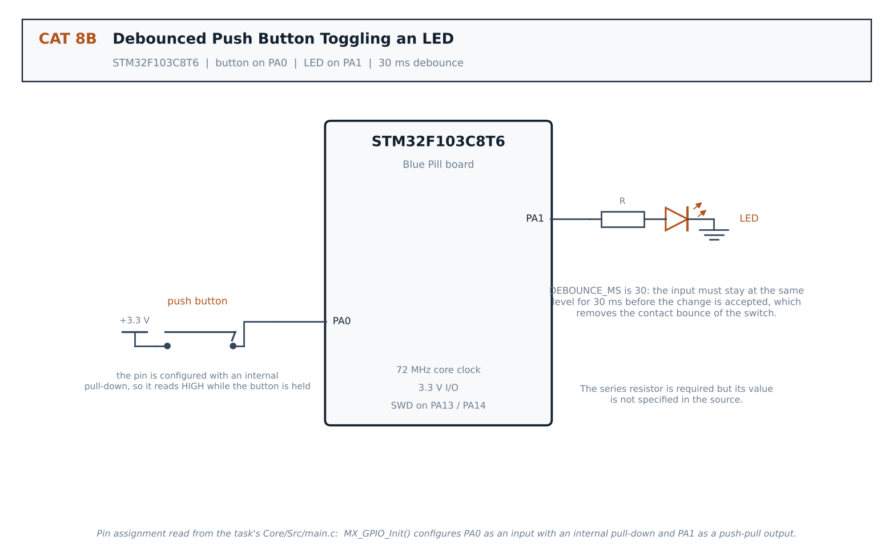

# CAT8B – STM32 Event-Based Switch Debouncing

**EXP:** CAT8B

**DATE:** 18/09/26

**NAME OF EXP:** STM32 Event-Based Control - Pushbutton Debouncing & State Latch

**HARDWARE SETUP / PLATFORM:**
- Microcontroller: STM32F103C8T6 (Blue Pill)
- Input: External tactile pushbutton on GPIO input pin with pull-up resistor
- Output: Status LED on PC13
- Framework: STM32 HAL

**TASK NO:**
1. Configure a GPIO pin as a digital input with internal pull-up.
2. Implement software debouncing to reject contact bounce on button press.
3. Toggle and latch the LED state upon each confirmed button press.

**Circuit Diagram:**

**Core Logic / Pseudocode / Code Base:**
- Poll input pin for active-LOW state (`HAL_GPIO_ReadPin() == GPIO_PIN_RESET`).
- Wait 20 ms debounce delay and re-check pin state.
- If still pressed, invert the output latch state (`HAL_GPIO_TogglePin()`).
- Wait in a loop until button is released (`while(HAL_GPIO_ReadPin() == GPIO_PIN_RESET)`) to prevent multiple toggles from a single press.

**INFERENCE:**
Software debouncing successfully eliminated false triggers caused by mechanical contact bounce. Exactly one LED state change was registered for each distinct button click.
