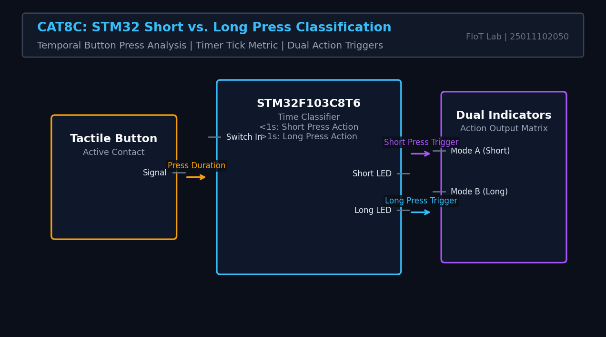

# CAT8C – STM32 Short Press vs. Long Press Classification

**EXP:** CAT8C

**DATE:** 18/09/26

**NAME OF EXP:** STM32 Temporal Button Press Classification (Short vs. Long Press)

**HARDWARE SETUP / PLATFORM:**
- **Microcontroller:** STM32F103C8T6 (Blue Pill)
- **Input:** Tactile pushbutton on GPIO input pin with pull-up resistor
- **Output:** Status LED indicator on PC13
- **Timer Mechanism:** 1 kHz ARM Cortex SysTick counter accessed via `HAL_GetTick()`

**TASK NO:**
1. Track the time of button press and button release using `HAL_GetTick()`.
2. Compute the press duration $\Delta t = t_{	ext{release}} - t_{	ext{press}}$.
3. Classify the duration into Short Press (< 1000 ms) or Long Press (≥ 1000 ms) and trigger distinct operational responses.

**Circuit Diagram:**



**Core Logic / Pseudocode / Code Base:**
```c
uint32_t press_start = 0;
uint32_t press_duration = 0;

if (HAL_GPIO_ReadPin(BUTTON_PORT, BUTTON_PIN) == GPIO_PIN_RESET) {
    HAL_Delay(20); // Debounce
    if (HAL_GPIO_ReadPin(BUTTON_PORT, BUTTON_PIN) == GPIO_PIN_RESET) {
        press_start = HAL_GetTick();
        while (HAL_GPIO_ReadPin(BUTTON_PORT, BUTTON_PIN) == GPIO_PIN_RESET); // Wait for release
        press_duration = HAL_GetTick() - press_start;

        if (press_duration < 1000) {
            // Short press: Toggle LED once
            HAL_GPIO_TogglePin(GPIOC, GPIO_PIN_13);
        } else {
            // Long press: Execute rapid 5-blink alert burst
            for (int i = 0; i < 5; i++) {
                HAL_GPIO_TogglePin(GPIOC, GPIO_PIN_13);
                HAL_Delay(100);
            }
        }
    }
}
```

**INFERENCE:**
Time-domain classification using the millisecond SysTick counter allows a single mechanical input to serve multiple control roles. Short clicks and sustained long presses were cleanly distinguished, expanding user interface capability without adding extra physical buttons.
