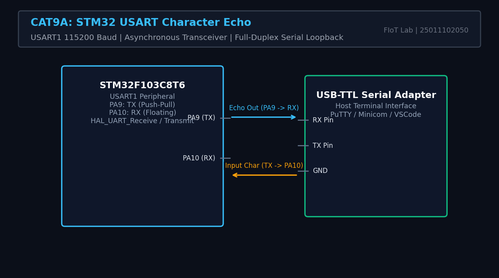

# CAT9A: STM32 USART1 Interactive Character Echo

## 🎯 Objective
Configure USART1 on STM32F103 for asynchronous full-duplex communication at 115200 Baud and implement a character loopback echo server interfacing with a host terminal.

## ⚡ Hardware Architecture & Pinout
- **MCU:** STM32F103C8T6 (72 MHz)
- **UART Pins:** `PA9` (USART1_TX, Alternate Function Push-Pull), `PA10` (USART1_RX, Input Floating).
- **Host Link:** USB-to-UART CP2102/CH340 adapter connected to PC.
- **Baud Configuration:** 115200 Baud, 8 Data Bits, 1 Stop Bit, No Parity (8N1).

## 🧠 Engineering Implementation
1. **HAL UART Peripheral Setup:** Configured `huart1` instance with 16x oversampling and hardware flow control disabled.
2. **Loopback Engine:**
   - `HAL_UART_Receive(&huart1, &rx_byte, 1, HAL_MAX_DELAY)` blocks until byte arrival.
   - `HAL_UART_Transmit(&huart1, &rx_byte, 1, 100)` immediately re-transmits byte back to host.
3. **Data Integrity:** Line discipline verified across high-speed character bursts.

## 📊 Verification & Results
- Verified zero dropped characters in serial terminal at 115200 baud.
