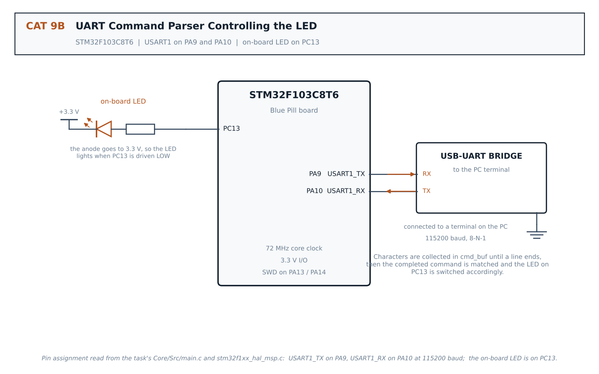

# CAT9B – STM32 USART Command Parser ("ON" / "OFF" / "TOGGLE")

**EXP:** CAT9B

**DATE:** 28/09/26

**NAME OF EXP:** String-Based Application Logic (LED ON / OFF / TOGGLE) via UART

**HARDWARE SETUP / PLATFORM:**
- Microcontroller: STM32F103C8T6
- Serial Bus: USART1 (PA9/PA10) at 115200 Baud
- Actuator: On-board LED on PC13

**TASK NO:**
1. Receive incoming characters over USART1 into a line buffer until newline (`
` or `
`).
2. Parse string commands using `strcmp`.
3. Control the LED state according to commands `"ON"`, `"OFF"`, and `"TOGGLE"`, returning confirmation messages.

**Circuit Diagram:**

**Core Logic / Pseudocode / Code Base:**
- Characters accumulate in `rx_buffer[]` until a carriage return is received.
- Null-terminate the string and compare:
  - If `strcmp(buf, "ON") == 0`: Turn LED ON (`HAL_GPIO_WritePin(GPIOC, GPIO_PIN_13, GPIO_PIN_RESET)`), reply `"OK: LED ON
"`.
  - If `strcmp(buf, "OFF") == 0`: Turn LED OFF, reply `"OK: LED OFF
"`.
  - If `strcmp(buf, "TOGGLE") == 0`: Toggle LED, reply `"OK: LED TOGGLED
"`.
  - Else: Reply `"ERR: Unknown Command
"`.
- Buffer index resets to 0 for the next command.

**INFERENCE:**
A simple and responsive command-line interpreter was implemented on STM32. The system correctly parsed text commands and controlled physical hardware with confirmation feedback.
